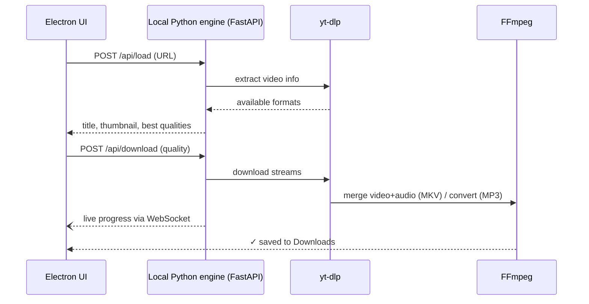

# 🎥 YTDownloader4K - YouTube Video Downloader

[](https://opensource.org/licenses/MIT)
[](https://www.python.org/downloads/)
[](https://github.com/yt-dlp/yt-dlp)
[](https://github.com/ZabaHD4K/DescargadorYT/releases/tag/v2.0.0)

Download YouTube videos up to 4K or extract MP3 audio — with a beautiful, modern desktop app.

> **🆕 What's New in v2.0:**
> ✅ **All-new neumorphic interface** — soft modern design, light & dark mode, real thumbnails
> ✅ **Silent background auto-updates** — delta downloads, applied on next launch, zero dialogs
> ✅ **New architecture** — local Python engine (FastAPI + yt-dlp) + Electron UI, real-time progress over WebSocket
> ✅ Same trusted download engine: up to 4K, MKV merge, 192 kbps MP3
>
> [View Full Changelog](CHANGELOG.md)

<div align="center">

## 📥 Download

### **[⬇️ Download YTDownloader4K Installer (Windows)](https://github.com/ZabaHD4K/DescargadorYT/releases/download/v2.0.0/YTDownloader4K-Setup-2.0.0.exe)**

**One-click install • Windows 10/11 • Auto-updates itself**

[Release notes](https://github.com/ZabaHD4K/DescargadorYT/releases/tag/v2.0.0) · [Run from source](#-running-from-source)

</div>

---

## ✨ Features

- 🎨 **Modern neumorphic UI**: light & dark themes with smooth animated transitions
- 🎯 **Smart quality picker**: the two best resolutions of each video + MP3, one tap away
- 🖼️ **Video preview**: real thumbnail, title, channel and duration before downloading
- 📉 **Live progress**: real-time percentage, speed and ETA streamed from the engine
- 🎵 **Audio extraction**: high-quality 192 kbps MP3
- 🔄 **Silent auto-updates**: downloads in the background, applies on next launch
- 💾 **Smart downloads**: straight to your Downloads folder, resolution in the filename
- 🌍 **Geo-bypass** and automatic retry handling
- ⚡ **Powered by yt-dlp**: the most reliable YouTube engine, updated with every release

---

## 🔧 How It Works



The app is two pieces working as one: a **local Python engine** (FastAPI + yt-dlp,
running only on `127.0.0.1`) and an **Electron frontend**. The UI starts and stops
the engine automatically — you never see it.

FFmpeg is downloaded automatically on first run (one-time setup, a few seconds).

---

## 💻 Installation

1. **[Download the installer](https://github.com/ZabaHD4K/DescargadorYT/releases/download/v2.0.0/YTDownloader4K-Setup-2.0.0.exe)**
2. Windows SmartScreen may warn about an unknown publisher (the app is unsigned) → **More info → Run anyway**
3. Installs in seconds — no admin rights needed — and opens automatically

✅ **Everything included**: Python engine, yt-dlp and the UI are bundled. FFmpeg fetches itself on first run.
✅ **Auto-updates**: install once, stay current forever.

### Uninstall
Windows Settings → Apps → YTDownloader4K → Uninstall. Clean and standard.

---

## 🚀 Usage

1. **Paste** a YouTube URL and click **Load Video**
2. **Preview** the thumbnail and pick a quality chip (best resolutions + MP3)
3. **Press the download button** — files land in your **Downloads** folder
   (video as MKV with the resolution in the name, audio as MP3)

Bonus: tap the **sun/moon** in the title bar to switch light/dark mode.

---

## 🔄 Auto-Update

v2 updates itself silently:

1. On launch, the app checks GitHub Releases
2. If there's a new version it downloads **in the background** while you work — and only the changed parts (delta updates)
3. The update is applied automatically the next time you open the app

No dialogs, no manual downloads, no interruptions.

---

## 🖥️ System Requirements

- **OS**: Windows 10 or 11 (64-bit)
- **RAM**: 1 GB minimum
- **Storage**: ~400 MB + space for downloads
- **Internet**: required

---

## 🐍 Running from Source

For developers — see [`desktop/README.md`](desktop/README.md) for details.

```bash
git clone https://github.com/ZabaHD4K/DescargadorYT.git
cd DescargadorYT

# engine
pip install -r desktop/backend/requirements.txt

# UI (starts the engine automatically)
cd desktop/frontend
npm install
npm start
```

Backend API playground: `python desktop/backend/server.py` → http://127.0.0.1:8765/docs

### Building the installer

Releases are built automatically by GitHub Actions on `v2.x` tags
(`.github/workflows/release-desktop.yml`). Locally:

```bash
cd desktop/backend && pyinstaller ytd4k-backend.spec
cd ../frontend && npm run dist     # installer in frontend/dist/
```

---

## 📁 Project Structure

```
DescargadorYT/
├── desktop/                # ⭐ The app (v2)
│   ├── backend/            # Python engine: FastAPI + yt-dlp
│   └── frontend/           # Electron UI (neumorphic, light/dark)
├── src/                    # Legacy v1 app (Tkinter) — frozen, kept for reference
├── tests/                  # Format-selection regression tests (shared logic)
├── CHANGELOG.md
└── .github/workflows/      # CI: release-desktop.yml (v2) · release.yml (legacy v1)
```

---

## 🏛️ Legacy v1 (classic portable exe)

The original single-exe Tkinter app reached end of life at
[v1.7.5](https://github.com/ZabaHD4K/DescargadorYT/releases/tag/v1.7.5) and
**will not receive further updates**. It still works and can still be downloaded
from that release, but YouTube changes will eventually break old yt-dlp versions —
**v2 is the way**.

---

## 🐛 Troubleshooting

#### "Windows protected your PC" (SmartScreen)
The app is unsigned. Click **More info → Run anyway**.

#### "Video blocked by YouTube" / bot check
YouTube sometimes blocks specific videos with an anti-bot wall. Wait a few minutes
and try again, or try a different video — this is on YouTube's side.

#### "Backend not reachable"
Close and reopen the app (the local engine failed to start). Engine logs live in
`%TEMP%\ytd4k-backend.log` — attach them if you open an issue.

#### "Video unavailable"
The video might be private, deleted, or geo-restricted.

---

## 📄 License

This project is **open source** under the [MIT License](https://opensource.org/licenses/MIT).

Copyright (c) 2026 Alejandro Zabaleta

---

## 🤝 Contributing

1. 🐛 **Report bugs**: [open an issue](https://github.com/ZabaHD4K/DescargadorYT/issues)
2. 💡 **Suggest features**
3. 🔧 **Submit pull requests**

```bash
git clone https://github.com/ZabaHD4K/DescargadorYT.git
cd DescargadorYT
pip install -r desktop/backend/requirements.txt
python -m unittest discover -s tests -v     # run the tests
```

---

## 🌟 Acknowledgments

- [yt-dlp](https://github.com/yt-dlp/yt-dlp) — the download engine
- [FFmpeg](https://ffmpeg.org/) — media processing
- Built with ❤️ by **Alejandro Zabaleta**

<div align="center">

### ⭐ If you find this project useful, please consider giving it a star!

[Report Bug](https://github.com/ZabaHD4K/DescargadorYT/issues) · [Request Feature](https://github.com/ZabaHD4K/DescargadorYT/issues) · [Contribute](https://github.com/ZabaHD4K/DescargadorYT/pulls)

</div>
